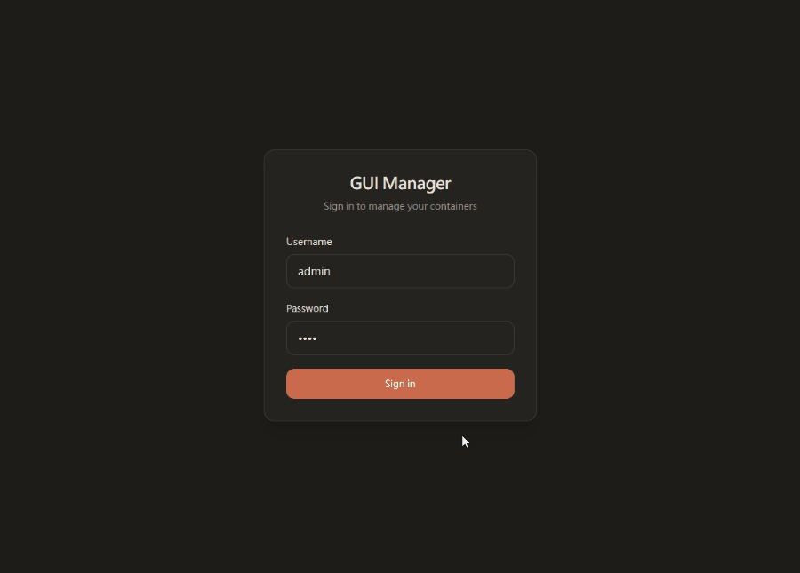
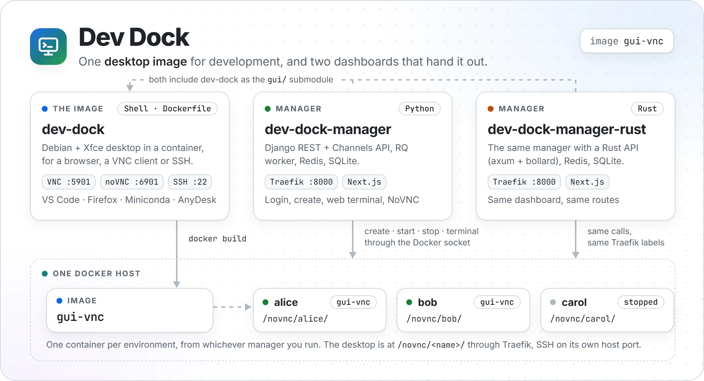
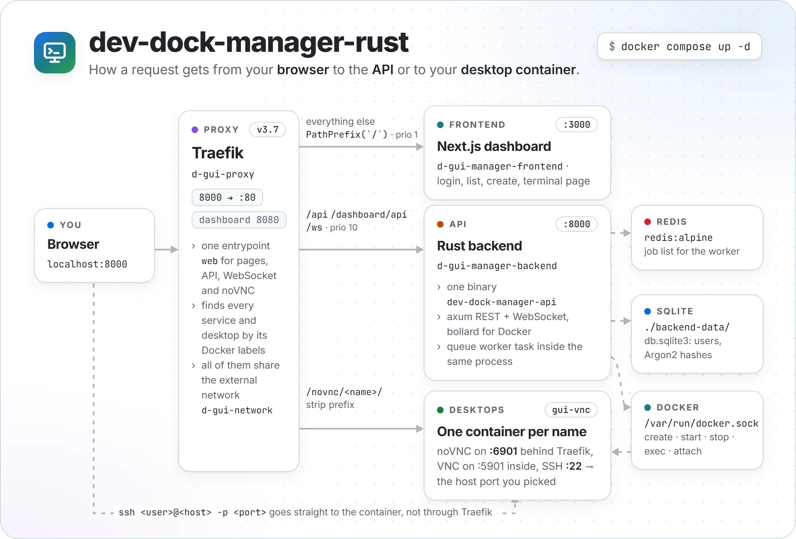
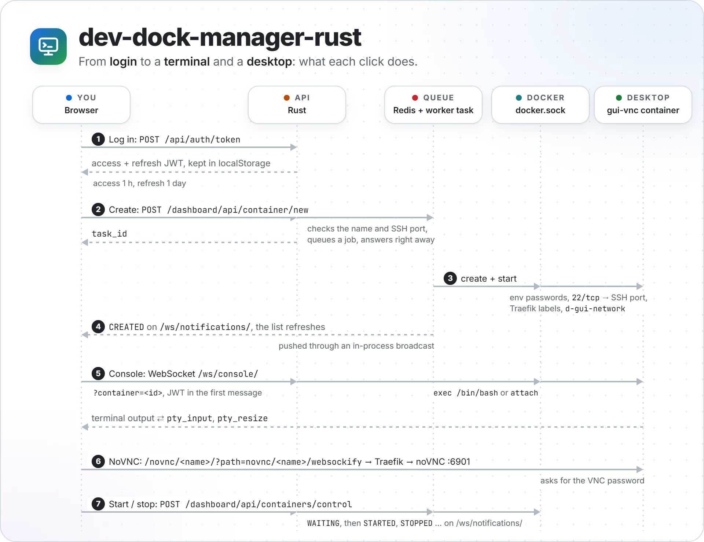
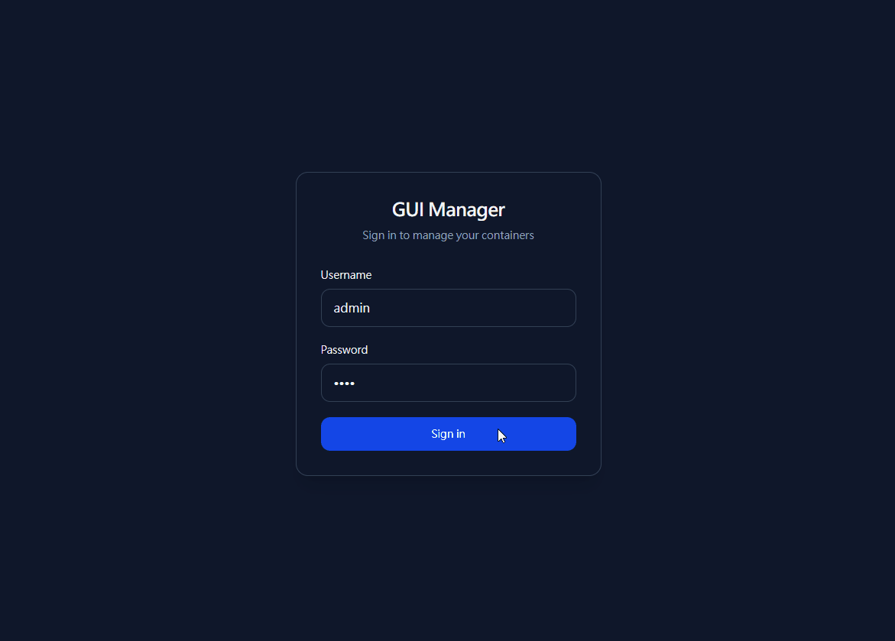
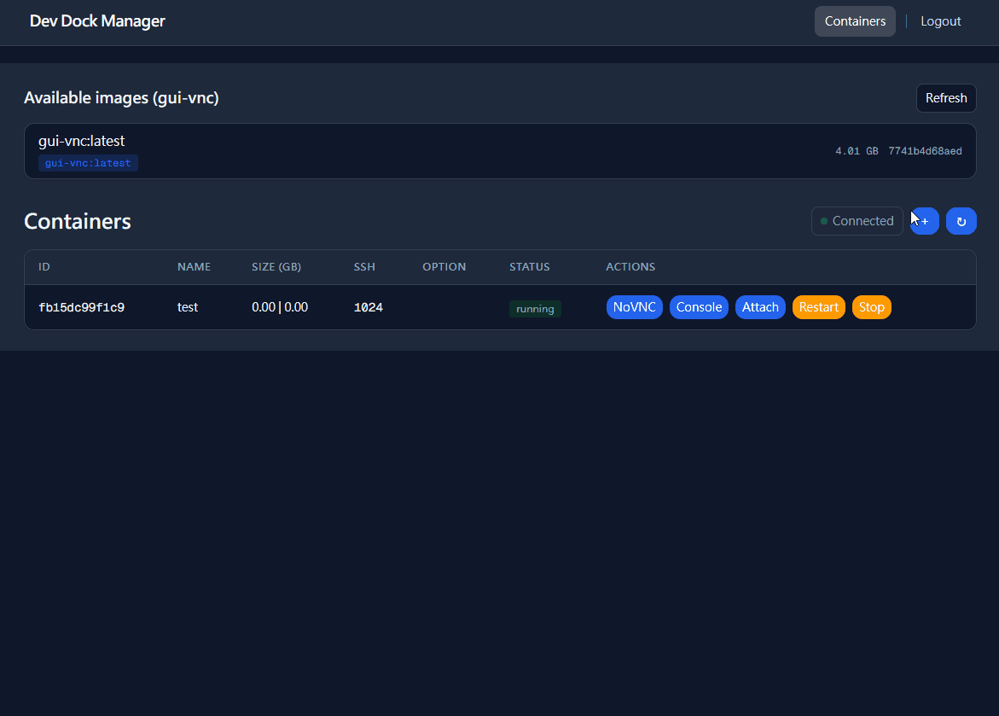
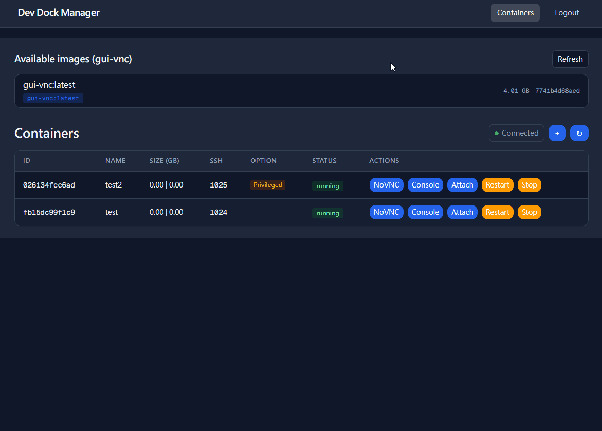
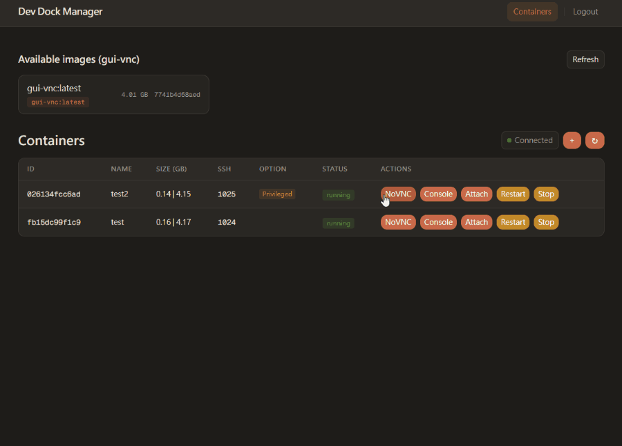

<div align="center">

# **Dev Dock Manager (Rust)**

<p>
  
</p>

<a href="https://github.com/NatLee/dev-dock-manager-rust/actions/workflows/backend.yml"></a>
<a href="./LICENSE"></a>

</div>

Dev Dock Manager is a small self-hosted dashboard for handing out Linux desktops on one machine. Each person
logs in, creates a container from the [dev-dock](https://github.com/NatLee/dev-dock) image, and gets a full
Xfce desktop in the browser (NoVNC), a web terminal and an SSH port, without touching Docker themselves. This
version has a Rust API (axum + bollard) and a Next.js frontend, all behind Traefik.

## The Dev Dock family

<p align="center">
  <picture>
    <source media="(prefers-color-scheme: dark)" srcset="docs/images/family-dark.webp">
    
  </picture>
</p>

| Repo | What it is |
|---|---|
| [dev-dock](https://github.com/NatLee/dev-dock) | The `gui-vnc` image: Xfce desktop, VNC, noVNC and SSH in one container. Included here as `gui/`. |
| **dev-dock-manager-rust** (this repo) | **The recommended manager.** Dashboard + Rust API. |
| [dev-dock-manager](https://github.com/NatLee/dev-dock-manager) | The older version of the same dashboard, with a Django (Python) API. |

## Why this one

Both managers have the same dashboard, the same routes, the same permission rules and the same account
pages, and start the same containers. Pick one per machine. This one is the recommended choice: one small
binary instead of Django + Daphne + an RQ worker under supervisord. In the measurements below it uses
about a fiftieth of the memory, starts in about half a second instead of eight, and answers the dashboard's
calls 2 to 15 times faster.

| Measured (median) | dev-dock-manager-rust | dev-dock-manager (Django) |
|---|---|---|
| Backend image size | **144 MB** | 687 MB |
| Backend memory when idle | **5.0 MiB** | 256 MiB |
| Start-up (`docker start` → API answers) | **0.58 s** | 8.3 s |
| Log in (`POST /api/auth/token`) | **18 ms** | 129 ms |
| Who am I (`GET /dashboard/api/me`) | **3.0 ms** | 13.8 ms |
| Container list (`GET /dashboard/api/containers`) | **478 ms** | 3,185 ms |
| Image list (`GET /dashboard/api/images`) | **324 ms** | 4,973 ms |
| Terminal metadata (`GET /dashboard/api/console/shell/<id>`) | **14 ms** | 27 ms |

How it was measured (2026-11-04):
- **Setup.** Both stacks were built from `main` and run one after the other on the same machine: 32 cores,
  32 GB RAM, Docker Desktop 29.8.1 on x86_64, Traefik v3.7, Redis, one running desktop. The repo's own
  compose file was used, with only names and ports changed.
- **Image size** is what `docker image inspect` reports for the backend image. Both frontend images are the
  same Next.js build, 295 MB each.
- **Memory** is the backend container in `docker stats`, after a minute with no requests (3 readings).
- **Start-up** is 5 runs of `docker stop` then `docker start` on the backend container, timed until
  `/api/auth/token` answered through Traefik.
- **Response times** come from 30 sequential requests per endpoint through Traefik, after 3 warm-up
  requests, all with status 200.
- **What it doesn't cover:** this is not a load test. The list endpoints depend on how much else runs on the
  Docker host (this one had about 90 unrelated images). Django is slower there mostly because docker-py
  inspects every image one by one and the container list also asks Docker for disk usage. Log-in time is
  mostly password hashing (Argon2 here, Django's PBKDF2 there).

Other differences:

| | dev-dock-manager-rust | dev-dock-manager |
|---|---|---|
| Background jobs | a worker task inside the API process, Redis list as the queue | a separate `rqworker` process (RQ) |
| Users | `users` table in SQLite, Argon2 password hashes | Django's users in SQLite |
| Login tokens | access 1 hour, refresh 1 day | access 60 hours, refresh 1 day |
| Extras | `/health` | Django admin and Swagger pages |

## How it works

<p align="center">
  <picture>
    <source media="(prefers-color-scheme: dark)" srcset="docs/images/architecture-dark.webp">
    
  </picture>
</p>

Everything you open goes through **Traefik** on port 8000, which picks the target by path:

| Path | Goes to |
|---|---|
| `/api/*`, `/dashboard/api/*`, `/ws/*` | the Rust API (`d-gui-manager-backend`, port 8000) |
| `/novnc/<name>/` | the noVNC page of the desktop called `<name>` (port 6901), with the prefix stripped |
| everything else | the Next.js dashboard (`d-gui-manager-frontend`, port 3000) |

Traefik learns these routes from Docker labels. The services get theirs from `docker-compose.yml`, and each
desktop gets its own when the API creates it. All of them share the external network `d-gui-network`. SSH is
the one thing that skips Traefik: each desktop publishes port 22 on a host port you choose.

<p align="center">
  <picture>
    <source media="(prefers-color-scheme: dark)" srcset="docs/images/lifecycle-dark.webp">
    
  </picture>
</p>

What each click does:

1. **Log in.** The dashboard posts your username and password to `/api/auth/token` and keeps the access and
   refresh tokens (JWT) in the browser's localStorage. Every API call sends the access token.
2. **Create.** The API checks the name (two characters or more, starting with a letter) and that the SSH port
   is free, puts a job on the Redis queue and answers with a `task_id` right away. Only admins may tick "privileged".
3. **The worker starts the container** from `gui-vnc`: your passwords as environment variables, port 22 on
   the SSH port you picked, `/etc/localtime` mounted read-only, the Traefik labels for `/novnc/<name>/`, and
   optionally privileged mode or all NVIDIA GPUs, plus the `dev-dock.owner` label with your user id.
4. **The list refreshes** when `CREATED` arrives on the `/ws/notifications/` WebSocket. Notifications only go
   to the desktop's owner and to admins.
5. **Console** (your own desktops only; admins: any) opens a WebSocket to `/ws/console/?container=<id>`, sends the token in the first message and
   gets a `bash` started with `docker exec` (a root shell). **Attach** connects to the container's main
   process instead. Keys and window size go up as `pty_input` and `pty_resize`.
6. **NoVNC** opens `/novnc/<name>/` through Traefik and asks for the VNC password you set when creating it.
7. **Start, stop, restart, remove** go through the same queue. You see `WAITING`, then `STARTED`, `STOPPED` and so on.

## Interface

- **Login**
  

- **Create container**
  

- **Web terminal**
  

- **NoVNC**
  

## Quick start

You need Linux with Docker running (the API talks to `/var/run/docker.sock`). On Windows, use Docker inside WSL.

1. **Get the code with the image submodule:**

   ```bash
   git clone --recurse-submodules https://github.com/NatLee/dev-dock-manager-rust.git
   cd dev-dock-manager-rust
   # already cloned? git submodule update --init --recursive
   ```

2. **Build the desktop image** (it ends up as `gui-vnc`; a first build takes 10 to 30 minutes and about 7.8 GB):

   ```bash
   cd gui && docker compose build && cd ..
   ```

   Or pull a pre-built one from [natlee/gui-vnc](https://hub.docker.com/r/natlee/gui-vnc) and name it
   `gui-vnc`, because that's the name the API starts containers from:

   ```bash
   docker pull natlee/gui-vnc:20260208-arm64
   docker tag natlee/gui-vnc:20260208-arm64 gui-vnc
   ```

3. **Set the login-token secret, create the network and start the stack:**

   ```bash
   cp .env.example .env
   sed -i "s|^JWT_SECRET=.*|JWT_SECRET=$(openssl rand -base64 48)|" .env
   docker network create d-gui-network
   docker compose build && docker compose up -d
   ```

   `JWT_SECRET` signs every login token, so it has no default: compose stops with a clear message if it's missing.

   The `nvidia-cuda` service only prints "CUDA image ready" and exits.

4. **Create the first admin:**

   ```bash
   ./dev-tool.sh create-superuser
   ```

   It asks for a username and password (defaults `admin` / `1234`; change it on the Account page right
   after). Everyone else gets an account from the **Users** page in the dashboard.

5. **Open http://localhost:8000/** and log in. It sends you to `/dashboard/containers`.

## Good to know

- **Opening it from another machine** just works: the dashboard talks to the API at whatever address it was
  opened from. `NEXT_PUBLIC_API_ORIGIN` in `frontend/.env.local` is only for running the frontend on its own
  (`npm run dev`), and Next.js bakes it in at build time.
- **Ports.** 8000 is the app, 8080 is the Traefik dashboard. Each desktop also takes the SSH port you pick.
- **Data.** Users live in `./backend-data/db.sqlite3`. The desktops are ordinary containers named after what
  you typed, so `docker ps` shows them.
- **Image name.** The API creates, lists and manages containers from the image named `DOCKER_IMAGE_NAME`
  (`gui-vnc` in `docker-compose.yml`), matched exactly, so a pulled image needs that tag.
- **Stopping.** The API handles SIGTERM and SIGINT, so `docker compose stop` ends it cleanly in about a second.

### Users and permissions

- **Users** see and control only the desktops they created: the list, the terminal, NoVNC links, start,
  stop and remove, and the live notifications. Someone else's desktop answers 404, as if it didn't exist.
  Users change their own password on the **Account** page.
- **Admins** see everyone's desktops (with an Owner column), are the only ones who can create privileged
  containers, and manage accounts on the **Users** page: create users, make them admin or user, disable or
  enable them, set a new password. Admins can't demote or disable themselves, so there's always a way back in.
- A disabled account can't log in, and the tokens it already had stop working on the next request.
- Ownership is a Docker label (`dev-dock.owner`) on each desktop. Desktops created before this existed have
  no owner, so only admins see them.

### Before you put it on a network

The API holds the Docker socket, so an admin account is effectively root on the host. The Traefik dashboard
on 8080 runs with `--api.insecure`, so don't expose that port. NoVNC pages are protected by each desktop's
VNC password, not by the dashboard login.

## NVIDIA GPU

Optional. With NVIDIA drivers and the NVIDIA Container Toolkit on the host, the create dialog lets you give a
container all GPUs (`/dashboard/api/nvdocker/check` tells the dashboard whether that works).

## Dev helper script

From the project root:

```bash
./dev-tool.sh --help
```

- `bash`: shell in the backend container (`d-gui-manager-backend`).
- `create-superuser`: create an admin (Rust `create-user … --staff`).
- `logs`: follow backend logs.
- `backend-debug`: run the backend in a one-off container with `RUST_LOG=debug`.

## API (backend)

- **Prefix**: `/api`, and the same routes again under `/dashboard/api`
  (e.g. `/api/auth/token`, `/dashboard/api/containers`, `/dashboard/api/ports`).
- **Health**: `GET /health` → `ok`, on the API itself (port 8000 inside the Docker network). Traefik doesn't
  route `/health`, so `localhost:8000/health` from the host reaches the frontend and returns 404.
- **Accounts**: `GET /me`, `POST /me/password` (`{current_password, new_password}`); admins only:
  `GET`/`POST /users`, `PATCH /users/:id` (`{is_admin?, is_active?, email?}`),
  `POST /users/:id/password` (`{new_password}`). New passwords need at least 8 characters.
- **Web terminal**: the frontend calls `GET /dashboard/api/console/:action/:id` for metadata, then opens the
  WebSocket `/ws/console/?container=<container_id>`. The first message must carry the JWT:
  `{"token": "<access token>", "action": "shell" | "attach", "payload": {"Id": "<container_id>"}}`.
  After that, `pty_input` and `pty_resize` messages carry keys and window size.
- **Notifications**: `/ws/notifications/` takes `{"token": "<access token>"}` as the first message, then pushes `{"message": {"action": "CREATED" | "STARTED" | …, "details": "…"}}`.

**Backend layout**: `backend/src/api/` (auth, containers, images, ports), `backend/src/ws/` (console and
notifications), `backend/src/docker/` (bollard), `backend/src/queue/` (Redis queue and worker),
`backend/src/db/` (users, SQLite + Argon2). See [backend/README.md](backend/README.md) for running it locally.

## License

[MIT](./LICENSE)
